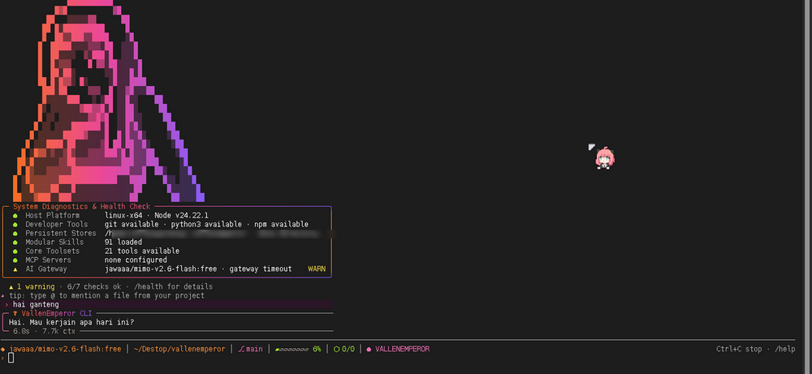

<p align="center">
  
</p>

<h1 align="center">VallenEmperor</h1>

<p align="center">
  <strong>Autonomous coding agent for the terminal — agent core, tool runtime, and CLI in one repo.</strong>
</p>

<p align="center">
  <a href="https://www.npmjs.com/package/vallenemperor"></a>
  <a href="https://www.npmjs.com/package/vallenemperor"></a>
  <a href="https://github.com/vallenmemek-ai/vallenemperor/actions/workflows/test.yml"></a>
  
  <a href="LICENSE"></a>
</p>

<p align="center">
  <a href="#install">Install</a> ·
  <a href="#preview">Preview</a> ·
  <a href="#quick-start">Quick start</a> ·
  <a href="#features">Features</a> ·
  <a href="#configuration">Configuration</a> ·
  <a href="#architecture">Architecture</a> ·
  <a href="#development">Development</a>
</p>

---

VallenEmperor is a terminal-native agent that actually executes: it reads and patches files, runs
commands, verifies its own work, resumes interrupted sessions, and loads skills on demand.

| Package | What it is |
| --- | --- |
| **`vallenagent`** | Agent core — turn loop, providers, tool registry, skills, memory, sessions, gateway |
| **`vallencli`** | Terminal UI — streaming cards, approval prompts, slash commands, config surface |

Both ship as one installable CLI: **`vallenemperor`**.

## Preview

<p align="center">
  
</p>

<p align="center">
  <sub>Real CLI startup: banner, health check (tools · skills · gateway), chat card and status bar.<br/>
  <code>1 warning · 6/7 checks ok</code> is the gateway fallback doing its job, not a mockup.</sub>
</p>

## Install

```bash
npm install -g vallenemperor
vallenemperor --version
```

Other ways:

```bash
npm install -g github:vallenmemek-ai/vallenemperor   # from GitHub (builds on install)
git clone https://github.com/vallenmemek-ai/vallenemperor && cd vallenemperor
npm install && npm run build && ./install.sh --install-vallencli
```

Requires **Node.js ≥ 20**. The published tarball already contains the compiled core, CLI sources,
bundled skill catalog and banner — no build step after `npm install -g`.

### Platforms

Linux, macOS, Windows and Termux run the same code path; the only per-OS pieces live in
`vallenagent/src/core/platform.ts` (shell discovery, process-tree kill, Python lookup, chmod).

| Host | Shell used by the `terminal` tool | Install |
| --- | --- | --- |
| Linux / macOS | `bash` (falls back to `sh`) | `./install.sh` |
| Termux (Android) | `bash` from `$PREFIX` | `pkg install nodejs-lts && ./install.sh` |
| Windows | PowerShell 7 (`pwsh`) → Windows PowerShell 5.1 → `cmd.exe` | `.\install.ps1` |

Notes:

- `better-sqlite3` is optional: when it cannot build (Termux arm64, Windows without build tools)
  session search falls back to a plain-text scan instead of failing.
- Windows launchers are `bin/vallenemperor.cmd` / `bin/vallenemperorcli.cmd`; `npm install -g`
  generates the same shims automatically.
- A legacy Windows console (no Windows Terminal, no `WT_SESSION`) automatically switches to
  ASCII output and no colour. Force it anywhere with `VALLEN_ASCII=1`.

## Quick start

```bash
# interactive REPL
vallenemperor

# one-shot prompt
vallenemperor -p "explain the last commit and list risky changes"

# resume the most recent session (or a specific id)
vallenemperor --resume
vallenemperor --resume session-1794163801765

# per-run overrides
vallenemperor --model gpt-4o-mini --approval dangerous

# machine-readable telemetry / clean output for scripts
vallenemperor --json -p "/stats"
vallenemperor --quiet
```

One-shot runs have nobody to answer an approval prompt, so a risky tool call is
**refused** and the process exits non-zero. Add `--approval off` for trusted
scripts that must run shell commands unattended.

Pick a model interactively — `/model` lists the live provider/account list from your gateway
(9router, OpenRouter, …), then the models behind it:

```text
/model          # ↑/↓ provider → Enter → ↑/↓ model → Enter
/model save     # persist the choice
```

Configure a provider without hand-editing JSON:

```bash
vallenemperor config set provider openrouter   # openai | anthropic | deepseek | 9router | ollama
vallenemperor config show
```

Keys stay in the environment (`OPENROUTER_API_KEY`, `OPENAI_API_KEY`, `ANTHROPIC_API_KEY`,
`DEEPSEEK_API_KEY`) — never in `config.json`.

## Features

- **Real tool loop** — `read_file`, `patch`, `patch_batch`, `write_file`, `terminal`,
  `process_manage`, `web_search`, `web_extract`, `browser_exec`, `execute_code`, MCP tools, media.
- **Atomic verification** — edits dirty the evidence groups they require (typecheck / test / build);
  a turn cannot claim "done" without the matching proof.
- **Sessions that survive** — persisted sessions, `/resume`, per-turn checkpoints, compaction.
- **Skills on demand** — bundled catalog, `skill_view`, hub search/install, per-turn relevance
  scoring; auto-loaded skills are released when the topic changes.
- **Clarify policy** — asks only when a decision truly blocks, never for style, naming, or
  "should I continue?".
- **Approval gates** — risky shell commands and sensitive paths gated; large diffs previewed first.
- **Provider presets** — OpenAI, Anthropic, OpenRouter, DeepSeek, local 9router, Ollama.
- **Telegram gateway** — pairing, allowlist, inline approvals, background jobs.
- **Turn artifacts** — files created/changed, saved outputs, verification commands, reported at the
  end of every turn.

## Configuration

Config lives at `~/.vallenemperor/config.json` (override with `VALLENEMPEROR_HOME`).

```jsonc
{
  "providers": {
    "active": "openrouter",
    "openrouter": { "base_url": "https://openrouter.ai/api/v1", "model": "openrouter/auto", "enabled": true }
  },
  "approval": "dangerous",       // dangerous | all | off
  "max_iterations": 500,
  "max_tokens_per_turn": 400000
}
```

| Variable | Purpose |
| --- | --- |
| `VALLENEMPEROR_HOME` | Data home (default `~/.vallenemperor`) |
| `VALLENEMPEROR_APPROVAL` | Force approval mode for the process |
| `OPENAI_API_KEY` / `ANTHROPIC_API_KEY` / `OPENROUTER_API_KEY` / `DEEPSEEK_API_KEY` | Provider keys |
| `VALLENEMPEROR_SKILLS_CATALOG` | `owner/repo` for the external skill catalog |

Data home also holds `sessions/`, `session-search.sqlite`, `memories/`, `checkpoints/`, `skills/`,
`logs/`, `gateway/`, and `skills_hub/` (lock file, quarantine, audit log).

## Architecture

```text
vallenagent/src/
  agent/       turn stages: setup → provider call → verification gate → tool dispatch → finalize
  providers/   OpenAI-compatible, Anthropic, router failover
  tools/       registry + builtin tools (file, terminal, web, mcp, media, state)
  skills/      SKILL.md loading, relevance scoring, preload budget
  skills_hub/  catalog search, quarantine, install, lock file
  memory/      MEMORY.md + deep memory with source quoting
  session/     sessions, checkpoints, todo, SQLite search index
  gateway/     Telegram adapter, router, daemon
  core/        config, approval policy, project context, cron

vallencli/src/
  cli.mjs           REPL, argument parsing, one-shot mode, config commands
  cli-ui.mjs        rendering: cards, status bar, approval boxes, diffs
  cli-markdown.mjs  markdown and code-fence renderer
  cli-commands.mjs  slash commands (/model, /skills, /resume, /plan, ...)
```

Each folder owns an `index.ts` barrel; the root `src/index.ts` only re-exports folders, so a new
module is added in exactly one place. The turn loop is split per stage — every stage is a module
with explicit dependencies, pinned by tests instead of by one thousand-line function.

## Turn artifacts

Every turn that produces work leaves a reviewable record, not just chat text:

```text
~/.vallenemperor/artifacts/<session>/turn-<n>/
  walkthrough.md      request, result, files created/changed, verification commands
  screenshot-*.png    captured by the browser_screenshot tool
  index.json          manifest (kind, name, bytes, timestamp)
```

Print it with `/artifacts`, or open the directory printed after each turn. `browser_screenshot`
drives a headless browser and saves a PNG into that turn's folder — proof that UI work actually
renders.

## For AI agents

If you are an AI starting fresh in this repository (new session, cleared context, different tool),
read in this order:

1. **[AGENTS.md](AGENTS.md)** — entry point, invariants, definition of done
2. **[RULES.md](RULES.md)** — binding rules: owner gate, versioning, evidence, secrets, git
3. **[docs/PROJECT.md](docs/PROJECT.md)** — architecture and where code belongs
4. **[docs/TESTING.md](docs/TESTING.md)** — how to test
5. **[docs/RELEASING.md](docs/RELEASING.md)** — release pipeline (the owner holds the publish button)
6. **[docs/DECISIONS.md](docs/DECISIONS.md)** — decisions not to reverse by accident

In short: never publish without the owner's explicit approval, bump the patch version for every
change and install it (`npm install -g .`), prove changes with real test output, never read or commit
`.env`, and never claim a result you did not observe.

## Development

```bash
npm test          # vallenagent + vallencli suites (node --test, no network)
npm run typecheck # tsc --noEmit
npm run build     # compile core + syntax-check CLI
```

293 tests cover the turn loop and event order, provider retries and truncated-answer continuation,
verification gates, skill relevance/release, patch engine, process manager, deferred tools, clarify
policy, provider presets, the Telegram gateway (injected HTTP client, no network), and the CLI
surface. CI runs the same three commands on every push and pull request.

Releasing:

```bash
./scripts/release.sh patch              # test → bump → npm publish
./scripts/release.sh patch --otp=123456 # 2FA accounts (TOTP)
```

## License

MIT © [vallenganteng](https://github.com/vallenmemek-ai)
