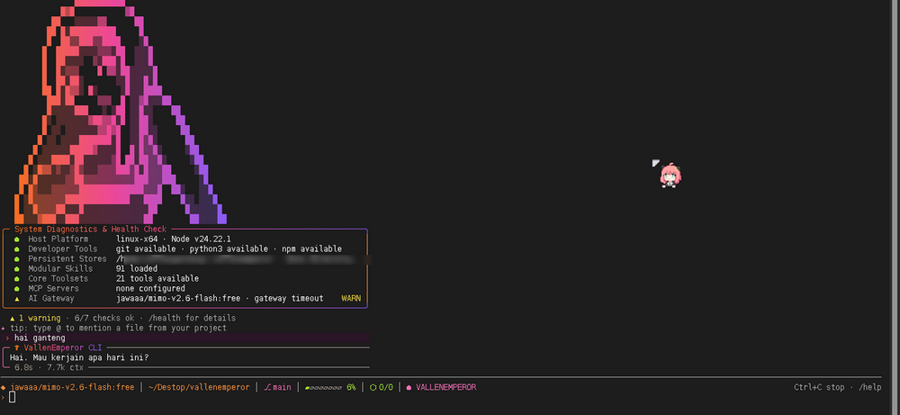

<p align="center">
  
</p>

<h1 align="center">vallencli</h1>

<p align="center"><strong>The terminal surface of VallenEmperor: REPL, rendering, approvals, slash commands.</strong></p>

<p align="center">
  <a href="../README.md">← Back to VallenEmperor</a>
</p>

---

`vallencli` is the CLI package in this monorepo. Users install it as **`vallenemperor`** — this
workspace package supplies the `bin` entry and the terminal UI, while `vallenagent` supplies the
engine.

## Usage

<p align="center">
  
</p>

```bash
vallenemperor                     # interactive REPL
vallenemperor -p "prompt"         # one-shot: print the answer and exit
vallenemperor --resume [id]       # resume the last session, or a specific id
vallenemperor --approval all      # dangerous | all | off for this run
vallenemperor --model <name>      # model override for this run
vallenemperor --help              # every flag
```

Unknown flags are rejected with exit code 2 instead of silently starting the REPL.

## Config commands

```bash
vallenemperor config show                    # active provider, base_url, key source, validation
vallenemperor config set provider deepseek   # openrouter | openai | anthropic | deepseek | 9router | ollama
vallenemperor config set model <name>
vallenemperor config set approval dangerous|all|off
```

Presets fill `base_url` + default model; API keys are read from the environment and are never
written to `config.json`.

## Slash commands

`/model`, `/token`, `/sessions`, `/resume`, `/new`, `/stats`, `/context`, `/search`, `/memory`,
`/todos`, `/tools`, `/skills` (search · install · uninstall · update · installed · stats · history ·
undo · enable · disable · sync · reset), `/review`, `/plan`, `/plans`, `/gamedev`, `/output`,
`/cd`, `/mcp`, `/project`, `/init`, `/checkpoints`, `/diff`, `/undo`, `/compact`, `/auto`, `/health`,
`/perf`, `/clear`, `/theme`, `/sh`, `/pty`, `/help`.

## UI behaviour

- Streaming answers render into a framed card with markdown, code fences and diffs.
- Every tool call collapses to one line unless it produced a diff or failed.
- Edits changing more than 20 lines always show their diff in the approval box — even in
  `dangerous` mode — and cannot ride on an "always allow" grant.
- Non-interactive runs (`-p`) never wait for approval input.

## Structure

```text
src/
  cli.mjs           REPL, argument parsing, one-shot mode, config commands
  cli-ui.mjs        cards, status bar, approval boxes, diff rendering, themes
  cli-markdown.mjs  markdown + code-fence renderer
  cli-commands.mjs  slash command implementations
  cli-files.mjs     @path file mentions and completion
  cli-suggest.mjs   inline command suggestions
  cli-theme.mjs     color levels and gradients
```

## Development

```bash
npm run build   # node --check src/cli.mjs
npm test        # node --test tests/*.test.mjs
```

The suite drives the real `runCli` loop with fake agents and captured streams: flag parsing, config
subcommands, approval flows, rendering, markdown, and the global-install symlink case.
